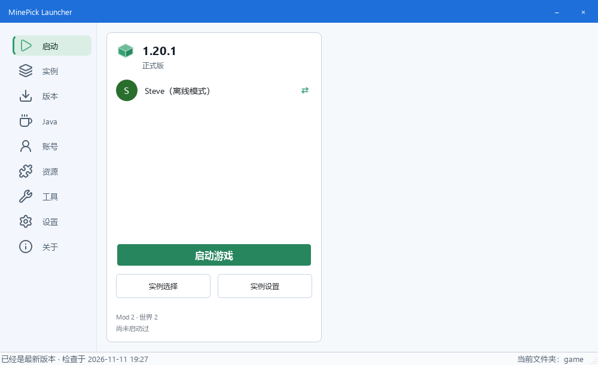
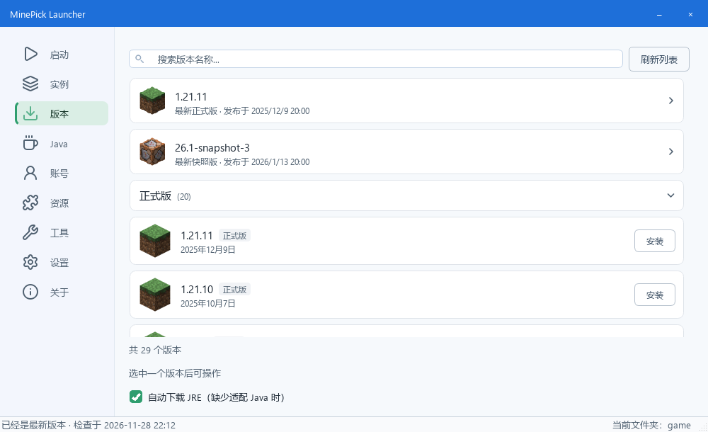
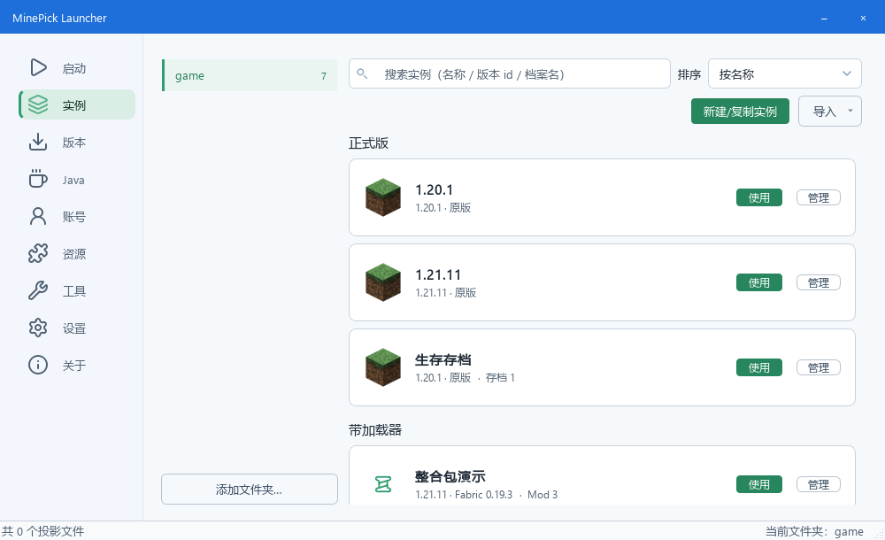
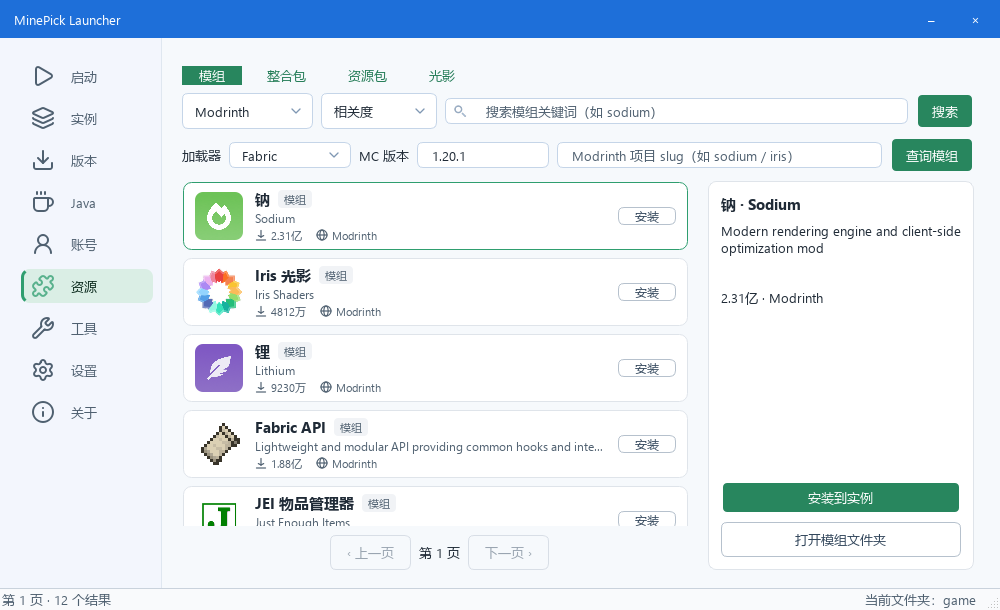
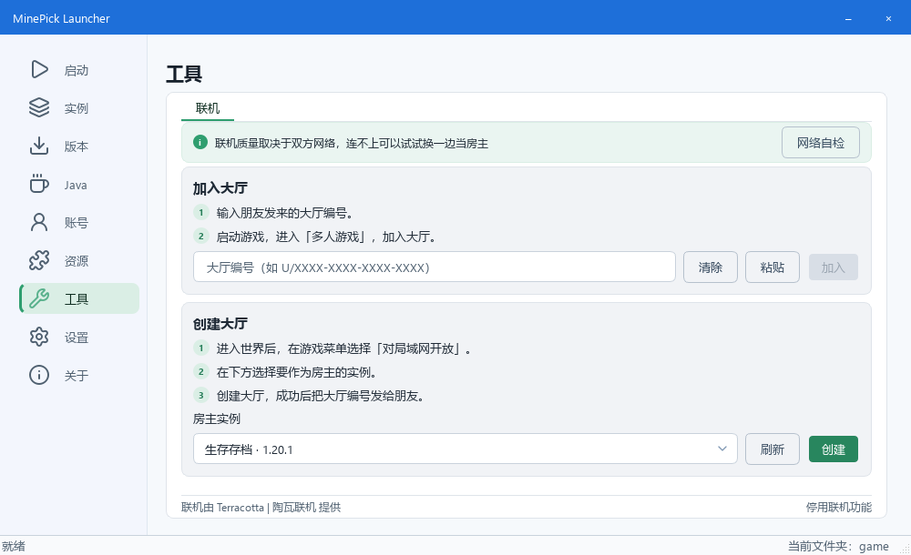
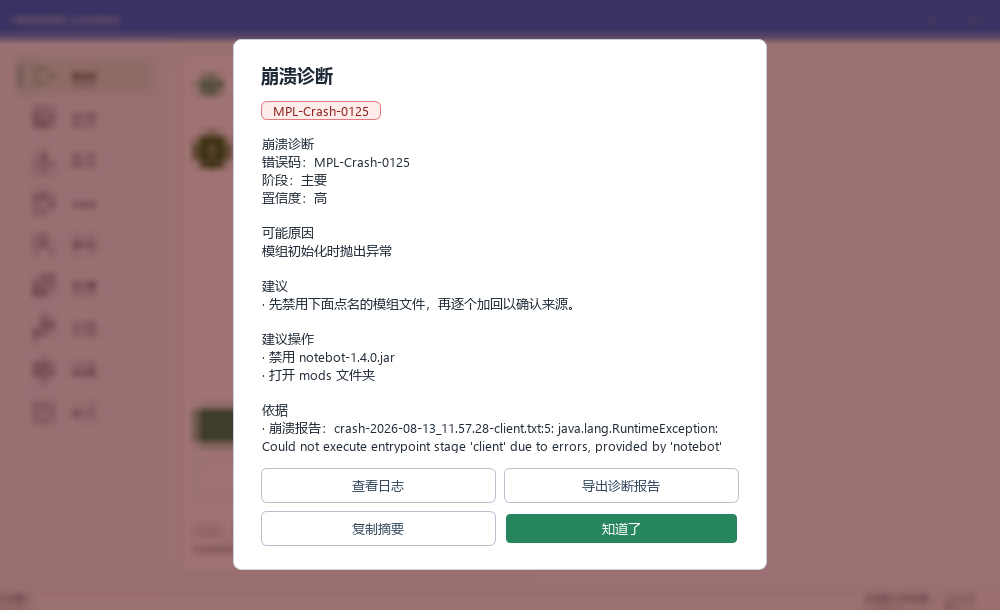

[English](README.md) | **简体中文** | [繁體中文](README_zh_TW.md) | [日本語](README_ja.md) | [한국어](README_ko.md) | [Русский](README_ru.md) | [Français](README_fr.md) | [Español](README_es.md) | [Deutsch](README_de.md)

# MinePick Launcher

[](https://github.com/XLTX-Git/MinePick_Launcher/actions/workflows/ci.yml) [](https://github.com/XLTX-Git/MinePick_Launcher/releases) [](https://github.com/XLTX-Git/MinePick_Launcher/blob/main/LICENSE) [](https://github.com/XLTX-Git/MinePick_Launcher/blob/main/pyproject.toml)

基于 Python + PySide6 的便携版 Minecraft 启动器：微软账号登录 / 离线模式、版本安装、Modrinth 与 CurseForge 资源、
Fabric/Forge/NeoForge/Quilt 加载器、实例隔离管理 —— 打包为免安装单文件 EXE。

**当前版本 0.4.2** —— 只提供 GUI 版，本仓库不含命令行可执行文件。

## 截图

<table>
  <tr>
    <td></td>
    <td></td>
  </tr>
  <tr>
    <td align="center"><sub>启动</sub></td>
    <td align="center"><sub>版本</sub></td>
  </tr>
  <tr>
    <td></td>
    <td></td>
  </tr>
  <tr>
    <td align="center"><sub>实例</sub></td>
    <td align="center"><sub>资源</sub></td>
  </tr>
  <tr>
    <td colspan="2"></td>
  </tr>
  <tr>
    <td colspan="2" align="center"><sub>工具 › 联机</sub></td>
  </tr>
  <tr>
    <td colspan="2"></td>
  </tr>
  <tr>
    <td colspan="2" align="center"><sub>崩溃诊断对话框</sub></td>
  </tr>
</table>

## 界面

- **窗口内的首次向导** —— 欢迎流程是主窗口里的覆盖层（左侧步骤栏、右侧内容、底部操作栏），不再是独立弹窗；
  完成后直接关闭并交回主窗口
- **自定义窗口框架** —— 标题栏由启动器自绘，风格跟随主题；左侧只有窗口标题文字，
  右侧是最小化与关闭按钮；镐子图标用于任务栏、文件图标与对话框
- **外观可自定义** —— 强调色（填任意 16 进制色码、8 个预设色块、系统取色器）、界面字体（系统已安装的全部字体，
  常用置顶，输入即过滤）、界面圆角（紧凑 / 默认 / 圆润）、主题（深色 / 浅色 / 跟随系统）
- **版式更清楚** —— 各顶层页面不再有页头，内容从顶部直接开始、全局统一的间距规范、搜索框内嵌放大镜图标
- **交互更安静** —— 滚动条只在鼠标移入列表时出现、焦点描边只对键盘导航显示、切页有淡入过渡、
  表格列宽会被记住、点表头即可排序
- **状态更易读** —— 按钮分三级（主操作 / 次要描边 / 危险红描边）、状态文字按严重程度着色、空列表会告诉你下一步做什么
- **默认即无障碍** —— 对比度按颜色令牌逐个校验（两套主题 × 8 个强调色：正文 ≥4.5:1、非文本 ≥3:1），
  每个可交互控件都有可读名称，键盘焦点始终可见

## 无障碍

- 我们**不宣称「符合 WCAG 2.2 AA」** —— WCAG 是写给网页内容的，而本程序是桌面应用；我们宣称的是其中
  **适用于桌面程序**的 A / AA 条款。
- 每次改动都由机器校验（界面回归脚本，见「开发」一节）：文字与背景的配对**从颜色令牌枚举**
  （两套主题 × 8 个强调色；正文 ≥4.5:1、非文本 ≥3:1）、可点目标 ≥24×24 像素、全键盘可达且键盘能到达的
  落点**都有可见焦点**、每个可交互控件都有可读名称、悬停提示**可移入且不会自行消失**、
  状态消息会主动告知辅助技术。
- **未做**：读屏软件（NVDA / 讲述人）人工走查。悬停提示的「可移入、不自动消失」由自动化测试覆盖，
  它在真实窗口管理器下的表现**尚未人工复核**；仍未验的真机项只有两条：表格与「来源」下拉的**播报顺序**，
  以及上一条悬停提示。状态消息的播报已在真机实测通过。
- 已知问题：下载或更新仍在进行时关闭程序可能崩溃。详见发布说明。

## 启动器功能

### 账号
- 微软设备码登录（自动打开授权页并把授权码复制到剪贴板），带实时轮询状态
- 离线模式；多账号列表一键切换；皮肤头像；令牌自动续期
- 可选令牌加密（cryptography Fernet + 密码，支持 `MCLAUNCHER_TOKEN_PASSWORD`）

### 版本与 Java
- 官方版本清单，按类型分组的可折叠版本列表（正式版 / 快照版 / 愚人节版本 / 远古版）、「最新正式版 / 最新快照版」卡片、
  版本名搜索、一键安装与卸载、版本详情
- 隔离按实例单独决定 —— 始终隔离、不隔离，或跟随全局默认
  （实例内已有模组或存档时会自动保留独立文件夹）
- Java 需求映射（1.16.5→8、1.17–1.20.4→17、1.20.5–1.21.11→21、26.1+→25；26.1 起 Mojang 改用「年份.序号」编号），支持 Adoptium 自动下载与运行时管理器

### 启动与实例
- 按模组数量与可用内存给出内存建议、自定义 JVM 参数、服务器直连、游戏语言、
  「启动游戏后」三选一（保持开启 / 自动隐藏 / 自动退出）、启动后收缩启动器占用的内存而不退出
- 实例就是版本文件夹：每个已安装的版本**本身**就是一个实例，既不重复占用空间，也无须事先创建；
  每个实例各自保留独立的存档 / 模组 / 配置，以及隔离、Java、内存、JVM 参数与额外游戏参数上的单独覆盖 ——
  每一项都可以跟随全局值，也能一键恢复默认
- 实例页由列表与详情视图组成，详情视图分为概览、模组、资源、存档、设置与诊断页签；实例支持备注、重命名
  与导入导出；本地模组管理会读取 jar 元数据（Fabric / Quilt / NeoForge / Forge / mcmod.info），
  支持启用 / 禁用、搜索筛选与拖入安装

### 崩溃与启动诊断
- 启动失败或游戏异常退出时，启动器会读取游戏日志、崩溃报告、可能存在的 `hs_err` 文件，以及它刚刚监视
  的那次运行的输出，再与内置知识库比对，说明**很可能发生了什么、为什么会这样、该怎么处理**，并给出
  稳定的错误码（启动器一侧的故障为 `MPL-Launch-####`，游戏一侧的崩溃为 `MPL-Crash-####`）
- 说明会显示在对话框里，可导出为报告（访问令牌与用户路径均已脱敏），也可复制错误码与摘要；
  自动分析可以关闭，每次诊断都会按实例记录。诊断分析完全在本机进行，这部分内容不会上传

### 资源
- 来自 **Modrinth** 与 **CurseForge** 的模组 / 资源包 / 光影 / 整合包，每个页签按下载量排序、每页 30 条可翻页，
  关键词搜索（含社区中文译名）、一键安装、`.mrpack` 整合包安装

### 关于与更新
- **「关于」页**：显示当前版本、查看源代码、许可与法律信息、第三方鸣谢，并内置更新检查（把本机版本与 GitHub 最新发布比对）
- **自动更新四档**：自动下载并安装、自动下载并提示（默认）、仅提示有新版本、不自动检查；无法自动安装时一律回退为打开发布页

## 系统要求

- Windows 10 / 11（64 位）。程序是免安装的单文件 EXE，自带运行时，不需要另外安装 Python、
  .NET 或 VC++ 运行库。
- 首次运行会在 EXE 同目录生成 `config/`，请放在有写权限的位置（例如桌面或自建文件夹），
  不要放进 `Program Files` 这类需要管理员权限的目录。
- 开发需要 Python 3.11+（见下面的「开发」一节）。

## 下载与使用

到 Releases 页下载 `MinePick_Launcher.exe`，双击即用 —— 免安装、无控制台窗口。首次运行会在 EXE 同目录生成
`config/` 文件夹，配置、账号与实例都留在这一个文件夹里。

所有设置都在界面内调整：**改完即生效，没有保存按钮。**

> 此版本使用自签名证书（WDNDXLTX），他人电脑的 SmartScreen 可能提示「未知发布者」，
> 点「更多信息 → 仍要运行」即可。

## 开发

```powershell
pip install -r requirements-dev.txt
python -m gui                # run the GUI
pytest -q                    # tests
ruff check launcher gui tests
```

打包与签名：`pyinstaller build_exe.spec` → `scripts/sign_exe.ps1`（见 `docs/code_signing_zh.md`）。
打包产物为**单个 GUI 版 EXE**（构建前置条件见 `docs/github_release_zh.md`）。

一条命令跑完整界面检查（测试 + lint + 对比度/溢出/高 DPI + 圆角审计 + 截图）：

```powershell
python tools/ui_regression.py            # add --quick to skip the screenshots
```

主题机制（占位符、可调项挂钩、如何新增一个可调项）：`docs/theming_zh.md`。

## 许可证

GPL-3.0-only —— 见 [LICENSE](LICENSE)。每次发布附带的源码包（`Source_code.zip`）满足 GPL 的源码分发要求。

## 相关项目

- [MinePick Launcher Classic](https://github.com/XLTX-Git/MinePick_Launcher_Classic) —— 本项目的前身，已归档（GUI + CLI）
- [MinePick Launcher Revision](https://github.com/TheDarkLord234/MinePick_Launcher_Revision) —— 由社区成员基于主线改制的修订版
